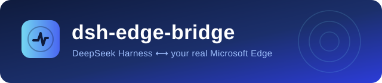

<p align="center">
  
</p>

<p align="center">
  <a href="README.md">中文</a> | <strong>English</strong>
</p>

<p align="center">
  <a href="LICENSE"></a>
  <a href="https://github.com/vfuncyy/dsh-edge-bridge/stargazers"></a>
  <a href="plugin/package.json"></a>
  <a href="extension/manifest.json"></a>
  <a href="#testing"></a>
</p>

# dsh-edge-bridge

Connect DeepSeek Harness to the **real Microsoft Edge** you already use. No more guessing at pages through `web_fetch`: the model can see your logged-in tabs, the dropdown you just expanded, the rows that only exist after scrolling. Read the body, map the structure, click by element, take screenshots — and push a whole page into your local knowledge base when that is what you need.

One host plugin, one MV3 extension, zero dependencies, zero daemons, loopback only.

> [!TIP]
> **Zero context cost when idle.** By default only a small `edge_bridge` control tool is registered. When you say "read the page in my browser", the model calls `start` and the seven browser tools appear from the next step. `stop` removes them again immediately.

## Contents

- [Why another browser bridge](#why-another-browser-bridge)
- [What you get](#what-you-get)
- [Install](#install)
- [Usage](#usage)
- [Security and limits](#security-and-limits)
- [Troubleshooting](#troubleshooting)
- [Testing](#testing)
- [Repository layout](#repository-layout)
- [Docs](#docs)
- [License](#license)

## Why another browser bridge

`web_fetch` returns the raw HTML the server sent: no session, no JavaScript, nothing behind a cookie wall or a "load more" button, nothing that only exists after you scroll. That is exactly where real work gets stuck — institutional databases, logged-in back offices, infinite lists, fields that appear only after a click.

Existing approaches each charge a price:

| Approach | What it costs |
| --- | --- |
| Cloud browser services (Browserbase and friends) | You hand over credentials or cookies; the page lives outside your control; billed per minute |
| Local automation platforms (Playwright driving its own Chromium) | That is a **new browser**, not a new capability: your sessions, your open tabs, your extensions are not there. Plus a few hundred MB of runtime and a daemon |
| **dsh-edge-bridge** | A plugin inside the DSH process and an extension inside the Edge you already run. Your session *is* the model's session, because it drives the tab you are looking at |

```
DSH model ──edge_* tools──▶ plugin (Bridge) ──ws://127.0.0.1:17333/edge-bridge──▶ Edge extension ──▶ your tabs
```

Three design choices explain the difference from comparable tools:

- **In-process, not a sidecar.** The plugin opens its listener inside DSH itself — no background service, no bundled binary. DSH starts, it is there; DSH exits, it is gone. The trade-off is that there is no standalone CLI, because its user *is* DSH.
- **Fixed port plus auto-discovery.** The plugin takes 17333 (walking forward within 17344 if taken) and the extension probes `GET /edge-bridge/ping` to find the real port. Your DSH web UI can move from 2556 to 4590 to 12218 without the bridge ever being reconfigured.
- **Designed to save the model tokens, not to look nice for humans.** Every tool renders a compact text report instead of handing the model a JSON tree to walk; `edge_inspect` dumps the whole page structure once, so the "guess a selector → fail → guess again" loop stops happening.

## What you get

After `edge_bridge(action="start")`, seven browser tools are available:

| Tool | In one line |
| --- | --- |
| `edge_status` | Connection state, endpoint, pairing token, per-connection extension version and **capabilities** |
| `edge_tabs` | List / open / navigate / activate / close / reload tabs, filtered by title or URL |
| `edge_inspect` | **Look before you touch**: heading outline, a stable `ref` plus selector and label for every clickable element, row and column counts for every table and repeated list |
| `edge_read` | Read the body as Markdown, plain text or HTML, with an outline and every link |
| `edge_eval` | Run JS in the page for structured data, with `$`/`$$`/`text`/`sleep`/`waitFor`/`waitText`/`clickText` built in |
| `edge_act` | click / type / hover / scroll / wait / select / press, with `ref` targeting, `expect` guards and an `effect_state` receipt |
| `edge_screenshot` | Save to `edge-artifacts/`, full-page supported |

Add the `edge_bridge` control tool and you have eight `edge_*` tools.

**v0.3.0 is about turning invisible failures into decidable ones:**

- **Stable `ref`.** `edge_inspect` stamps `data-dsh-ref="e12"` onto every visible control. Selectors drift when a page re-renders; a ref does not, because it lives on that DOM node.
- **`expect` before acting.** `edge_act(click, ref="e12", expect={text:"Delete"})` performs **nothing at all** if the label does not match, and the receipt says "expected X, found Y". Before clicking a hundred "confirm" buttons, this is worth more than anything else.
- **Three-state `effect_state`.** Every action ends with `committed` (the page really changed), `unknown` (dispatched, nothing changed yet — **do not blindly retry**, read or inspect first), or `none` (blocked by `expect`). Timeouts report `unknown` explicitly so you never have to guess whether something was clicked twice.
- **Capability negotiation.** The extension declares which methods it implements; the plugin rejects doomed calls up front and lists what is missing in `edge_status`. Upgrade the plugin and forget to reload the extension, and you get a sentence in plain language instead of a 15-second timeout.

There is also a path nothing else here offers: **three capture buttons in the extension popup** (start capturing / stop / capture every open tab). Pages do not land in some cache directory — they become `webpage` entries in your literature knowledge base, with snapshot, record and collection manifest all written, then indexed by `kb.py` so `kb.py search <keyword> --collection <name>` finds them. The host plugin does the file I/O, because **only it has filesystem access**; the extension only sends the intent.

## Install

### Requirements

| Item | Requirement |
| --- | --- |
| DeepSeek Harness | A build with `plugin_manager` bundles (desktop, web or TUI) |
| Microsoft Edge | 116 or newer (MV3 and `chrome.scripting`) |
| Node.js | Only for the test suite; the plugin and extension need no Node at runtime |

### 1. Install the host plugin

Install `plugin/` as a profile bundle:

```
plugin_manager(action="install_bundle", target="<absolute path>/edge-bridge/plugin")
```

It shows up as `dsh-edge-bridge` in the DSH plugin manager. Afterwards `edge_bridge(action="status")` must return an endpoint and a pairing token; the extension does not need to be connected for that.

After editing plugin sources the module cache will not refresh by itself — toggle the bundle:

```
plugin_manager(action="set_bundle", target="dsh-edge-bridge", enabled=false)
plugin_manager(action="set_bundle", target="dsh-edge-bridge", enabled=true)
```

### 2. Install the Edge extension

1. Open `edge://extensions/`.
2. Turn on **Developer mode**.
3. Click **Load unpacked** and pick the `extension` folder of this repository (the level that contains `manifest.json`).
4. A blue waveform icon appears in the toolbar; pin it from the puzzle menu if it is hidden.

> [!IMPORTANT]
> After changing **any** file under `extension/` (including `background.js`) you must click **Reload** for that extension in `edge://extensions/`.
> Restarting Edge after only touching `manifest.json` does not replace the service worker's code: you end up with a new version number running old behaviour. Since v0.3.0 the plugin calls that situation out directly in `edge_status`.

### 3. Pair

1. `edge_bridge(action="status")` gives you a `Pairing token`, e.g. `RgUMLbk8DB-gSXIGirDcnLKTNG9Q3pRs`.
2. Open the extension popup, paste the token into **pairing token**, leave the **endpoint** empty (empty means auto-discovery), and press **Save and connect**.
3. The popup goes green. `edge_status` reports `caps: 11 method(s)`.

The token is generated on first start and stored at `E:\.dsh\edge-bridge-token` (override with the `token` config key). Endpoint and token live in `chrome.storage.local` only and are never sent anywhere else.

### 4. Try it

```
edge_bridge(action="start")
edge_tabs(action="list", filter="github")
edge_inspect(tab_id=123)
edge_read(tab_id=123, include_links=true)
edge_bridge(action="stop")
```

## Usage

The full walkthrough is in **[docs/usage.md](docs/usage.md)**; it covers:

- every parameter of every tool, with real receipt samples
- correct and incorrect use of `ref`, `expect` and `effect_state`
- the workflow: inspect the structure → act on one element → extract data
- the three capture buttons, where files land, and the summary format
- all nine configuration keys
- permissions and limits: cross-origin iframes, `file://`, the `chrome.debugger` banner, restricted pages

Companion documents:

| Document | Contents |
| --- | --- |
| [Usage](docs/usage.md) · [使用指南](docs/使用指南.md) | Tool parameters, workflows, examples |
| [Configuration reference](docs/configuration-reference.md) · [配置参考](docs/配置参考.md) | Nine config keys, defaults, compatibility |
| [Troubleshooting](docs/troubleshooting.md) · [常见问题](docs/常见问题.md) | Symptom → cause → fix |
| [Internal architecture](docs/internal-architecture.md) · [内部架构](docs/内部架构.md) | Transport, lazy loading, capabilities, capture pipeline |
| [Changelog](docs/CHANGELOG.md) | Version differences |
| [Roadmap](docs/roadmap.md) · [路线图](docs/路线图.md) | What is planned, what is deliberately not |
| [Contributing](docs/CONTRIBUTING.md) · [贡献指南](docs/贡献指南.md) | Run the tests before opening a PR |

## Security and limits

- **Loopback only.** The plugin binds `127.0.0.1`, opens no public port and creates no reverse tunnel.
- **Token handshake.** The extension must present the pairing token; a wrong token closes the socket with `4003` and is recorded as `Last handshake error` in `edge_status`.
- **The extension sends intent, not files.** The host plugin does the writing. The extension never sees your knowledge base path.
- **File URLs need your explicit permission.** `file://` pages work only after you tick "Allow access to file URLs" for the extension in `edge://extensions`.
- **Cross-origin iframes are out of reach.** Content scripts and `Runtime.evaluate` act on the main frame only. `edge_inspect` reports `iframeCount`; open the iframe URL in its own tab instead.
- **`chrome.debugger` shows a banner.** MV3 forbids `eval` inside the extension, so `edge_eval` and full-page screenshots go through CDP, and Edge displays "…is debugging this browser". It disappears on disconnect; it is not a fault.
- **Restricted pages fail loudly.** `edge://*`, `chrome://*`, the extension store, the built-in PDF viewer and `about:blank` cannot be scripted, and the tools say so in readable language.

## Troubleshooting

The four most common cases; the full table is in [docs/troubleshooting.md](docs/troubleshooting.md):

| Symptom | Fix |
| --- | --- |
| `No Edge extension is connected yet` | The extension is not connected. Open the popup; leave the endpoint empty for auto-discovery |
| `No Edge Bridge found on 127.0.0.1:17333-…` | DSH is not running, or the plugin is disabled. `curl http://127.0.0.1:17333/edge-bridge/ping` must return `{"ok":true,…}` |
| `does not implement "page.inspect"` | The extension is old. Click **Reload** in `edge://extensions` |
| `edge_status` shows `caps: (not reported …)` | The service worker is still the old build. Same fix: **Reload** |

## Testing

Six suites, **318 assertions**. All but `test-page-in-edge` run without a browser.

```
node edge-bridge/tools/test-bridge.mjs        # transport, handshake, timeouts, disconnect, capability negotiation (27)
node edge-bridge/tools/test-plugin.mjs        # apply() → lazy registration → full fake-extension flow (76)
node edge-bridge/tools/test-server.mjs        # fixed port, walk-forward, ping discovery, routing (11)
node edge-bridge/tools/test-capture.mjs       # capture engine: snapshot, records, manifest, summary, isolation, removal, reader rejection (111)
node edge-bridge/tools/test-page-in-edge.mjs  # page.js parsing, interaction, refs and effect_state in headless Edge (59)
node edge-bridge/tools/test-contract.mjs      # cross-file contract: tool count, HOST_CAPS≡HANDLERS, ref/effect chain, version, docs wording (34)
```

`test-page-in-edge.mjs` launches a temporary headless Edge against `tools/fixture/page-fixture.html`; where a browser cannot start it prints `SKIP` and exits 0.

`test-contract.mjs` asserts nothing about behaviour — only the things that can be aligned solely by text: the tool count in `tools.js`, that `HOST_CAPS` in `bridge.js` and the `HANDLERS` keys in `background.js` are the same set, that the ref and effect chains connect across all four files, and that plugin and extension versions match. Rename a tool, add a method or bump a version and it speaks up before a behavioural test would.

## Repository layout

```
edge-bridge/
├─ plugin/                 # DSH host plugin (no runtime dependencies)
│  ├─ index.js             # apply(): listener + lazy controller + capture engine
│  ├─ cordis.patch.yml     # bundle insert and default config
│  ├─ locale/{en,zh}.json  # plugin manager strings
│  └─ lib/
│     ├─ server.js         # fixed-port http/ws listener + /ping discovery
│     ├─ ws.js             # hand-written RFC6455 server (handshake/framing/heartbeat)
│     ├─ bridge.js         # connection pool, hello auth, capabilities, request/reply, timeouts
│     ├─ controller.js     # lazy loading: edge_bridge(start/stop/status) + idle reclamation
│     ├─ capture.js        # capture engine: read page → knowledge base → session summary
│     ├─ kb.js             # KB writes: snapshot + entries.json + manifest + kb.py
│     ├─ tools.js          # the seven browser tool definitions and text rendering
│     └─ token.js          # pairing token generation and persistence
├─ extension/              # Edge MV3 extension
│  ├─ manifest.json
│  ├─ background.js        # service worker: dial, reconnect, dispatch (11 handlers)
│  ├─ page.js              # injected readPage / actPage / inspectPage
│  ├─ popup.html/js        # pairing, diagnostics, capture buttons
│  └─ icons/
├─ tools/                  # six suites + fixture + maintenance scripts
└─ docs/                   # documentation and assets
```

## Docs

Bilingual pairs: Chinese filenames for Chinese readers, plain `.md` for English readers.

- Getting started: [Usage](docs/usage.md) · [使用指南](docs/使用指南.md)
- Deployment: [Configuration reference](docs/configuration-reference.md) · [配置参考](docs/配置参考.md)
- Debugging: [Troubleshooting](docs/troubleshooting.md) · [常见问题](docs/常见问题.md)
- Internals: [Internal architecture](docs/internal-architecture.md) · [内部架构](docs/内部架构.md)
- History: [Changelog](docs/CHANGELOG.md) · [Roadmap](docs/roadmap.md)

## License

MIT, see [LICENSE](LICENSE). Third-party notices are in [NOTICE](NOTICE).
