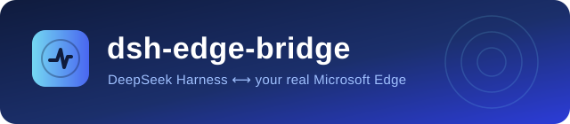

<p align="center">
  
</p>

<p align="center">
  <strong>中文</strong> | <a href="README.en.md">English</a>
</p>

<p align="center">
  <a href="LICENSE"></a>
  <a href="https://github.com/vfuncyy/dsh-edge-bridge/stargazers"></a>
  <a href="plugin/package.json"></a>
  <a href="extension/manifest.json"></a>
  <a href="#自测"></a>
</p>

# dsh-edge-bridge

把 DeepSeek Harness 接到你**真实的 Microsoft Edge 浏览器**上。模型不再隔着 `web_fetch` 猜页面长什么样：它能看见你已登录的标签页、点开的下拉框、滚动加载出来的列表，读正文、看结构、按元素操作、截图，必要时把整页抓进你的知识库。

一个 Host 插件 + 一个 MV3 扩展，零依赖、零守护进程、只走本机回环。

> [!TIP]
> **上下文成本为零**：默认只登记一个 30 行的 `edge_bridge` 控制工具。你说"读一下我浏览器里这个页面"，模型才 `start`，七个浏览器工具从下一步起出现；用完 `stop`，立刻从上下文消失。

## 目录

- [为什么还需要一个浏览器桥](#为什么还需要一个浏览器桥)
- [开发缘由](#开发缘由)
- [参考与致谢](#参考与致谢)
- [AI（DSH）参与说明](#aidsh参与说明)
- [能力一览](#能力一览)
- [安装](#安装)
- [详细用法](#详细用法)
- [安全与边界](#安全与边界)
- [免责与侵权删除声明](#免责与侵权删除声明)
- [排查](#排查)
- [自测](#自测)
- [项目结构](#项目结构)
- [文档](#文档)
- [许可证](#许可证)

## 为什么还需要一个浏览器桥

`web_fetch` 拿到的是服务器返回的原始 HTML：没有登录态、没有 JavaScript 渲染、没有弹层后面的真实内容、没有你滚到一半才加载的表格。真实工作里卡住的往往正是这些页面——机构数据库、必须登录的后台、无限滚动的列表、只有点开"更多"才出现的字段。

已有方案分两类，各有代价：

| 方案 | 代价 |
| --- | --- |
| 云端浏览器服务（Browserbase 之类） | 要把账号密码或 cookie 交出去；页面在你控制之外；按分钟计费 |
| 本地自动化平台（Playwright 驱动自带 Chromium） | 是一个**新浏览器**，不是一个新能力：你的登录态、你刚开着的标签页、你的扩展都不在里面；还要装几百 MB 运行时和一个守护进程 |

`dsh-edge-bridge` 走第三条路：**宿主插件直接挂在 DSH 进程里，扩展装进你每天用的那个 Edge**。没有额外运行时，没有中间进程，没有第二个浏览器。你的登录态就是模型的登录态——因为你操作的就是你正在看的那个标签页。

```
DSH 模型 ──edge_* 工具──▶ 插件(Bridge) ──ws://127.0.0.1:17333/edge-bridge──▶ Edge 扩展 ──▶ 你的标签页
```

三个设计取舍，决定了它和同类工具的差异：

- **进程内，不是旁路**：插件在 DSH 自己的进程里开监听，不留后台常驻进程、不装二进制。DSH 起了它就在，DSH 关了它就没。代价是没有脱离 DSH 的独立 CLI——因为它的用户就是 DSH。
- **固定端口 + 自动发现**：插件占 17333（被占则顺延到 17344 之内），扩展并行探测 `GET /edge-bridge/ping` 找到真实端口。所以 DSH Web UI 每次启动都可能换端口，桥接一次都不用重配。
- **为模型省 token 而设计，不是为人类省事**：每个工具返回紧凑的文本报告，不是让模型遍历 JSON 树；`edge_inspect` 一次给全页结构，避免"猜选择器 → 失败 → 再猜"的循环。

## 开发缘由

这个插件不是先有架构再找用途，而是被一件具体的事逼出来的。

日常要读的页面越来越多地落在**登录态后面**：机构数据库、只有滚动才加载的表格、点开"更多"才出现的字段、需要先勾选筛选条件才渲染的结果。这些页面用 `web_fetch` 拿到的永远是一个空壳——要么是登录页，要么是骨架屏。而当时的替代方案都不合适：把账号交出去不放心；为一个页面装一整套 Playwright 加重型 Chromium 又太贵，何况那台新浏览器里没有我的登录态。

真正需要的东西其实很小：**让我已经在用的那个 Edge，能被模型按需操作一下**。于是有了这个桥——不引入第二个浏览器，不引入守护进程，不引入 npm 依赖，装完就是 DSH 里多了一个控制工具。

后来它长出了第二个用途：抓取到的页面直接进文献知识库。因为"读到一个好页面"和"把这个页面归档进我的资料库"在真实工作里是同一件事，中间不该隔着下载目录和手工搬运。

## 参考与致谢

这个项目站在别人已经想清楚的地方起步，明确感谢：

- **[@Tencent](https://github.com/Tencent) / [BrowserSkill](https://github.com/Tencent/BrowserSkill)**（MIT）——本项目的"对照组"与主要借鉴来源。它把"agent 操作真实浏览器"这件事的系统性风险讲得比我们清楚：动作前断言、动作后结果三值化、扩展与宿主之间的能力协商，这三个机制直接来自它的问题意识。本项目的 `expect`、`effect_state` 与 `caps` 协商是按它提出的问题重新实现的，**代码一行未取**，实现与协议都不同（详见 [NOTICE](NOTICE)）。
- **[@T-Auto](https://github.com/T-Auto) / [dsh-ops](https://github.com/T-Auto/dsh-ops)**——本仓库的 README 版式、文档中英成对的组织方式、NOTICE 的归属写法，参照了 dsh-ops 的成熟做法。
- **DeepSeek Harness 与 Cordis**——插件运行其上的宿主与依赖注入框架，`cordis.patch.yml` 的 bundle 机制、`ctx.tools.register`、`plugin_manager` 热重载都来自它。
- 以及所有把浏览器自动化踩过的坑写成文档的人：CRD 调试协议、MV3 service worker 生命周期、`chrome.debugger` 与 DevTools 的互斥、`file://` 权限模型。

如果上述任何一处归属写错或遗漏，请开 issue，会立刻更正。

## AI（DSH）参与说明

这个仓库的代码与文档，**主要由 DeepSeek Harness 内的编码模型撰写**，人类作者负责提需求、定方向、验收与真实环境测试。具体分工：

| 环节 | 谁做的 |
| --- | --- |
| 需求、取舍、验收标准 | 人类作者 |
| 参考项目调研（BrowserSkill 的协议与工具面、dsh-ops 的文档风格） | DSH（读源码与 issue，产出对比结论） |
| 插件与扩展的实现（约 4,900 行）、六套测试（318 项）、十二篇文档 | DSH 撰写，人类逐轮 review |
| 真实浏览器验收（点击、断言阻断、`effect_state`、扩展重载时序） | 人类在真实 Edge 上操作并回报现象；DSH 据此定位并修复 |
| 缺陷判定与修复（如 `fingerprint()` 漏算正文导致 `committed` 误报 `unknown`） | DSH 定位与修改，人类复验 |

之所以写明这件事，是因为**使用者有权知道自己依赖的是什么样的产出**：这里的每一行都经过测试与真实浏览器验证，但它仍是一个由模型大量参与、由少数人在有限平台上验证过的项目。请按这个前提评估它在你的环境里的可靠性——特别是涉及不可撤销操作（提交表单、点"删除"、下单）时，先在小号或无副作用页面上试。

## 能力一览

`edge_bridge(action="start")` 之后，七个浏览器工具可用：

| 工具 | 一句话 |
| --- | --- |
| `edge_status` | 连接状态、端点、配对令牌、每条连接的扩展版本与**能力位**（caps） |
| `edge_tabs` | 列标签页 / 新开 / 跳转 / 激活 / 关闭 / 重载，可按标题或 URL 过滤 |
| `edge_inspect` | **先看结构再动手**：标题大纲、每个可点元素的稳定 `ref` + 选择器 + 文字、每张表与重复列表的行数与样例行 |
| `edge_read` | 读正文：Markdown / 纯文本 / HTML，附标题大纲与全部链接 |
| `edge_eval` | 在页面里跑 JS 取结构化数据，内置 `$`/`$$`/`text`/`sleep`/`waitFor`/`waitText`/`clickText` |
| `edge_act` | 点击 / 输入 / 悬停 / 滚动 / 等待 / 下拉选择 / 按键；支持 `ref` 定位、`expect` 前置断言、`effect_state` 三值回执 |
| `edge_screenshot` | 截图存到工作区 `edge-artifacts/`，支持整页 |

加上控制工具 `edge_bridge`，共八个 `edge_*`。

**v0.3.0 的重点是把"看不见的失败"变成"可判断的失败"**：

- **稳定 `ref`**：`edge_inspect` 给每个可见控件打上 `data-dsh-ref="e12"`。页面重渲染后选择器会漂到别的元素上，`ref` 不会——因为它是写在那个 DOM 节点上的。
- **动作前断言 `expect`**：`edge_act(click, ref="e12", expect={text:"删除"})`。文字对不上就**一步都不执行**，回执写明"期望 X，实际 Y"。在批量点掉一百个"确认"之前，这一步比什么都值。
- **`effect_state` 三值**：每次动作回执末尾一行 `committed`（页面确实变了）/ `unknown`（已派发但暂无变化，**不要盲目重试**，先 read 或 inspect）/ `none`（被 `expect` 拦住）。超时也会明确告诉你 `unknown`，而不是让你猜有没有点重。
- **能力位协商**：扩展在握手里声明自己实现了哪些 method，插件据此**提前拒绝**注定失败的回调，并在 `edge_status` 里列出缺哪些。装完新版插件忘了重载扩展时，你会得到一句人话，而不是一个 15 秒超时。

另外还有一条别人没有的路：**扩展弹窗里的三个抓取按钮**（启动抓取页面 / 停止抓取页面 / 批量抓取已打开的页面）。抓到的页面不是落到某个缓存目录，而是作为 `webpage` 条目写进你的文献知识库，快照、题录、专题清单三处齐备，随后 `kb.py` 建索引，`kb.py search 关键词 --collection 页面抓取` 直接可检索。真正的文件读写由宿主插件执行——**只有它有文件系统权限**，扩展只发指令。

## 安装

### 前置条件

| 项 | 要求 |
| --- | --- |
| DeepSeek Harness | 支持 `plugin_manager` bundle 的版本（桌面端 / Web / TUI 均可） |
| Microsoft Edge | 116 或更高（需要 MV3 与 `chrome.scripting`） |
| Node.js | 仅跑自测时需要；插件与扩展本身运行时**不需要** Node |

### 1. 安装 Host 插件

把 `plugin/` 目录作为 profile bundle 安装：

```
plugin_manager(action="install_bundle", target="<绝对路径>/edge-bridge/plugin")
```

在 DSH 插件管理页里也可以直接看到 `dsh-edge-bridge`。装上后 `edge_bridge(action="status")` 应返回端点与配对令牌——这一步不需要扩展已连接。

改动插件源码后模块缓存不会自动刷新，把 bundle 关掉再打开：

```
plugin_manager(action="set_bundle", target="dsh-edge-bridge", enabled=false)
plugin_manager(action="set_bundle", target="dsh-edge-bridge", enabled=true)
```

### 2. 安装 Edge 扩展

1. 打开 `edge://extensions/`。
2. 打开 **开发人员模式**。
3. 点 **加载解压缩的扩展**，选择本仓库的 `extension` 文件夹（即包含 `manifest.json` 的那一层）。
4. 工具栏出现蓝色波形图标；没显示就点拼图图标固定出来。

> [!IMPORTANT]
> 修改 `extension/` 里任何文件（包括 `background.js`）之后，必须回 `edge://extensions/` 点该扩展的 **重新加载**。
> 只改 `manifest.json` 的重启不会替换 service worker 的代码：你会遇到"版本号是新的、行为还是旧的"。v0.3.0 起插件会在 `edge_status` 里直接把这种情况点出来。

### 3. 配对

1. `edge_bridge(action="status")` 拿到 `Pairing token`，例如 `YOUR-PAIRING-TOKEN`。
2. 点扩展图标，把令牌粘进 **配对令牌**，**连接地址留空**（留空 = 自动发现），点 **保存并连接**。
3. 状态变绿 `已连接`。`edge_status` 会显示 `caps: 11 method(s)`。

令牌首次启动时自动生成并落在 `<DSH_HOME>\edge-bridge-token`（可用配置项 `token` 覆盖）。地址与令牌只存在 `chrome.storage.local`，不外发。

### 4. 试一下

```
edge_bridge(action="start")
edge_tabs(action="list", filter="github")
edge_inspect(tab_id=123)
edge_read(tab_id=123, include_links=true)
edge_bridge(action="stop")
```

## 详细用法

完整用法见 **[docs/使用指南.md](docs/使用指南.md)**，包含：

- 每个工具的**全部参数**与真实回执样例
- `ref` / `expect` / `effect_state` 的正确用法与反例
- 结构转储 → 定点操作 → 结构化抽取的完整工作流
- 页面抓取三按钮、知识库落盘位置、会话总结格式
- 配置项九键全表（端口、令牌、空闲回收、知识库路径…）
- 权限与边界：跨域 iframe、`file://`、`chrome.debugger` 提示条、受限页面

配套文档：

| 文档 | 内容 |
| --- | --- |
| [使用指南](docs/使用指南.md) · [Usage](docs/usage.md) | 工具参数、工作流、示例 |
| [配置参考](docs/配置参考.md) · [Configuration](docs/configuration-reference.md) | 九个配置键、默认值、兼容性 |
| [常见问题](docs/常见问题.md) · [Troubleshooting](docs/troubleshooting.md) | 现象 → 原因 → 处理 |
| [内部架构](docs/内部架构.md) · [Architecture](docs/internal-architecture.md) | 传输层、懒加载、能力位、抓取管线 |
| [变更日志](docs/CHANGELOG.md) | 版本差异 |
| [路线图](docs/路线图.md) · [Roadmap](docs/roadmap.md) | 想做什么、不做什么 |
| [贡献指南](docs/贡献指南.md) · [Contributing](docs/CONTRIBUTING.md) | 提 PR 前请先跑自测 |

## 安全与边界

- **只监听回环**：插件绑 `127.0.0.1`，不开放任何公网端口，不建立反向隧道。
- **令牌握手**：扩展必须先出示配对令牌；令牌错 → 服务端 `4003` 关闭，并在 `edge_status` 记下 `Last handshake error`。
- **扩展只发意图**：写文件的是宿主插件，扩展没有 `file://` 之外的额外权限，也不接触你的知识库路径。
- **允许访问文件 URL 需要你显式打开**：`file://` 页面在 `edge://extensions` 里勾选该扩展的"允许访问文件 URL"之后才可用。
- **跨域 iframe 读不到**：content script 与 `Runtime.evaluate` 都只作用于主框架。`edge_inspect` 会显示 `iframeCount`，正确做法是把 iframe 的 URL 单独开一个标签页。
- **`chrome.debugger` 会留提示条**：MV3 的 CSP 禁止扩展内 `eval`，所以 `edge_eval` 与整页截图走 CDP，Edge 顶部会出现"正在调试此浏览器"。断开后消失，不是异常。
- **明确拒绝而不是静默失败**：`edge://*`、`chrome://*`、扩展商店、PDF 内置查看器、`about:blank` 这些页面无法注入脚本，工具会给出可读的错误。

## 免责与侵权删除声明

**按"现状"提供。** 本项目为个人与团队自用工具，作者不对其适用性、可靠性、无中断运行或特定用途的适配作任何明示或暗示的担保。使用本插件与扩展产生的全部后果——包括但不限于误点击、误提交、误删除、账号被第三方服务判定为自动化、被目标网站封禁、数据写入错误——由使用者自行承担。

**操作真实浏览器意味着真实后果。** 这个工具驱动的是你已登录的浏览器，它的点击会真正生效。作者强烈建议：涉及金钱、提交、删除、发布、不可撤销状态变更的操作，先在无副作用的账号或页面上验证；`edge_act` 的 `expect` 前置断言与 `effect_state` 三值回执正是为降低这类风险而设计，请按文档使用，不要跳过。

**不绕过任何访问控制。** 本项目不提供验证码破解、反爬对抗、付费墙绕过、登录态劫持能力，也不接受把这类用途作为 issue 的讨论方向。请遵守你所访问网站的《服务条款》与 `robots.txt`，遵守所在司法辖区的法律。因违反上述条款而产生的责任由使用者承担。

**商标与从属关系。** "Microsoft"、"Edge"、"Chromium"、"DeepSeek"、"DeepSeek Harness"、"Cordis" 等名称与标识为其各自权利人的商标。本项目与 Microsoft Corporation、Tencent、DeepSeek 及其他任何组织**没有隶属、赞助或背书关系**。本项目是独立的第三方插件，不是官方组件。

**第三方内容与侵权处理。** 本仓库不含任何第三方源码。若你认为本仓库的任何文件（代码、文档、图片、示例）侵犯了你的著作权、商标权、专利权或商业秘密，请在 [Issues](https://github.com/vfuncyy/dsh-edge-bridge/issues) 中提出，或通过仓库所有者页面联系维护者，注明**具体文件路径、你的权利依据、以及期望的处理方式**。承诺如下：

1. 收到有效通知后 **72 小时内**响应，先行下架或移除被指内容，不等争议解决；
2. 若为误报，可在补充权利说明后恢复；
3. 不做"先删后议"之外的报复性动作，不追究善意投诉者的责任。

**关于本仓库中的个人信息。** 发布前已对开发过程中残留的本机信息做过脱敏处理：配对令牌、本机绝对路径、真实标签页 ID、个人知识库路径、本机端口演进等具体取值均已替换为占位符或通用默认值（例如令牌改为 `YOUR-PAIRING-TOKEN`、知识库根目录改为 `$DSH_HOME/knowledge-base`）。仓库中保留的 `vfuncyy` 仅作为仓库所有者与徽章链接出现。若仍发现残留的个人或本机信息，请开 issue 指出路径，会立即处理。

## 排查

最常见的四个，完整表见 [docs/常见问题.md](docs/常见问题.md)：

| 现象 | 处理 |
| --- | --- |
| `No Edge extension is connected yet` | 扩展没连上。点扩展图标看状态；地址留空走自动发现 |
| `No Edge Bridge found on 127.0.0.1:17333-…` | DSH 没跑，或插件被关。`curl http://127.0.0.1:17333/edge-bridge/ping` 应返回 `{"ok":true,…}` |
| `does not implement "page.inspect"` | 扩展是旧版。到 `edge://extensions` 点**重新加载** |
| `edge_status` 显示 `caps: (not reported …)` | service worker 还是旧构建。同上，点**重新加载** |

## 自测

六套测试，共 **318 项断言**。除 `test-page-in-edge` 外不需要浏览器。

```
node edge-bridge/tools/test-bridge.mjs        # 传输层 + 握手/超时/断线/能力位协商（27 项）
node edge-bridge/tools/test-plugin.mjs        # apply() → 懒加载 → 假扩展全链路（76 项）
node edge-bridge/tools/test-server.mjs        # 固定端口 + 顺延 + ping 发现 + 路由（11 项）
node edge-bridge/tools/test-capture.mjs       # 抓取引擎：快照/题录/清单/总结/失败隔离/删除/阅读器拒绝（111 项）
node edge-bridge/tools/test-page-in-edge.mjs  # 无头 Edge 里验证 page.js 的解析、交互、ref 与 effect_state（59 项）
node edge-bridge/tools/test-contract.mjs      # 跨文件契约：工具计数、HOST_CAPS≡HANDLERS、ref/effect 链路、版本、文档口径（34 项）
```

`test-page-in-edge.mjs` 会临时起一个无头 Edge 加载 `tools/fixture/page-fixture.html`；环境不允许启动浏览器时打印 `SKIP` 并退出 0。

`test-contract.mjs` 不测行为，只断言那些**只能靠文字对齐**的东西：`tools.js` 的工具数、`bridge.js` 的 `HOST_CAPS` 与 `background.js` 的 `HANDLERS` 方法名集合完全一致、ref 与 effect 链路在四个文件里都接得上、插件与扩展版本号相同。改工具名、加 method、升版本时，它比行为测试更早报错。

## 项目结构

```
edge-bridge/
├─ plugin/                 # DSH Host 插件（零运行时依赖）
│  ├─ index.js             # apply(): 监听 + 懒加载控制器 + 抓取引擎
│  ├─ cordis.patch.yml     # bundle 插入声明与默认配置
│  ├─ locale/{en,zh}.json  # 插件管理页文案
│  └─ lib/
│     ├─ server.js         # 固定端口 http/ws 监听 + /ping 发现
│     ├─ ws.js             # 手写 RFC6455 服务端（握手/分帧/心跳）
│     ├─ bridge.js         # 连接池、hello 鉴权、能力位、请求-应答、超时
│     ├─ controller.js     # 懒加载：edge_bridge(start/stop/status) + 空闲回收
│     ├─ capture.js        # 抓取引擎：读页面 → 交知识库 → 写作业总结
│     ├─ kb.js             # 知识库写入：快照 + 条目.json + 清单 + kb.py
│     ├─ tools.js          # 七个浏览器工具定义与文本渲染
│     └─ token.js          # 配对令牌生成/持久化
├─ extension/              # Edge MV3 扩展
│  ├─ manifest.json
│  ├─ background.js        # service worker：拨号、重连、方法分发（11 个 handler）
│  ├─ page.js              # 注入页面的 readPage / actPage / inspectPage
│  ├─ popup.html/js        # 配对、诊断、抓取按钮
│  └─ icons/
├─ tools/                  # 六套测试 + fixture + 运维脚本
└─ docs/                   # 文档与素材
```

## 文档

中英成对：中文文件名给中文读者，`*.md` / `*.zh.md` 之外的英文文件给英文读者。

- 入门：[使用指南](docs/使用指南.md) · [Usage](docs/usage.md)
- 部署：[配置参考](docs/配置参考.md) · [Configuration reference](docs/configuration-reference.md)
- 排错：[常见问题](docs/常见问题.md) · [Troubleshooting](docs/troubleshooting.md)
- 原理：[内部架构](docs/内部架构.md) · [Internal architecture](docs/internal-architecture.md)
- 演进：[变更日志](docs/CHANGELOG.md) · [路线图](docs/路线图.md)

## 许可证

MIT，见 [LICENSE](LICENSE)。第三方组件的许可与归属见 [NOTICE](NOTICE)。
